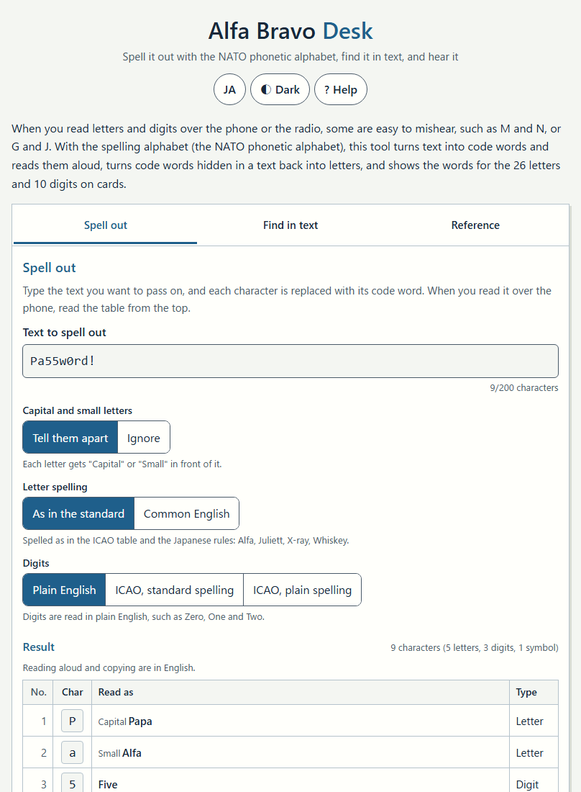
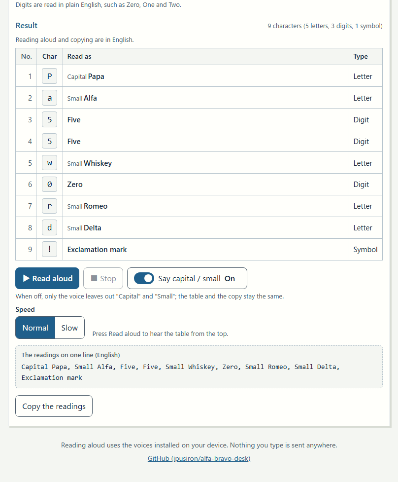
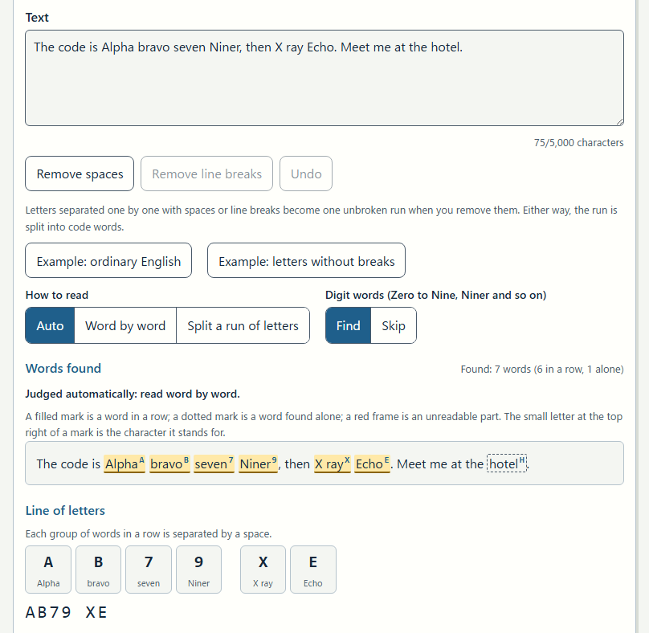
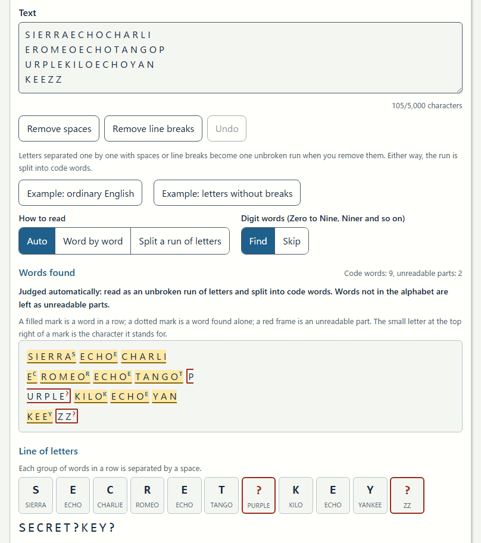
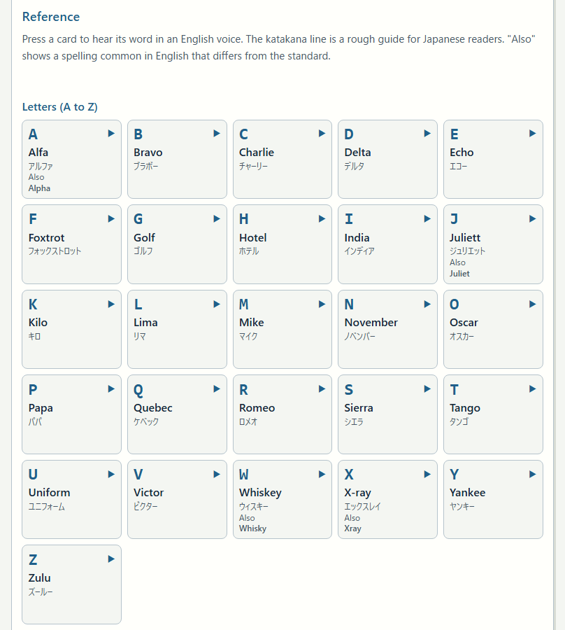
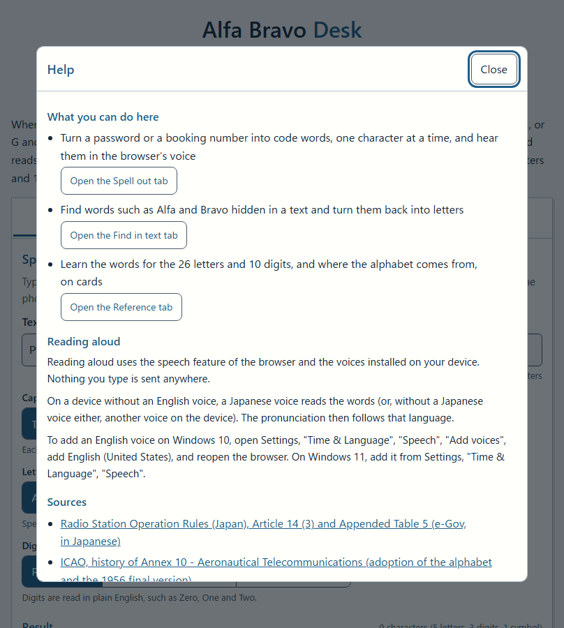

English · [日本語](README.md)

# Alfa Bravo Desk - Spell it out with the NATO phonetic alphabet, find it in text, and hear it

[](https://github.com/ipusiron/alfa-bravo-desk/stargazers)
[](https://github.com/ipusiron/alfa-bravo-desk/forks)
[](https://github.com/ipusiron/alfa-bravo-desk/commits)
[](LICENSE)
[](https://ipusiron.github.io/alfa-bravo-desk/)

**Day129 - 200 Security Tools with Generative AI**

Alfa Bravo Desk is a tool for the NATO phonetic alphabet, the spelling alphabet used to pass letters and digits over the phone or the radio without mishearing, from both ends: the one who reads it out and the one who writes it down. It has three tabs: Spell out turns text into code words one character at a time and reads them aloud in the browser's voice; Find in text turns code words hidden in a text or in an unbroken run of letters back into letters; Reference shows the words for the 26 letters and 10 digits on cards.

It also covers how to tell capital and small letters, 0 and O, and 1 and l apart when you pass a password or a booking number over the phone. Reading aloud uses the voices installed on your device, and nothing you type is sent anywhere.

## 🌐 Demo

👉 **[https://ipusiron.github.io/alfa-bravo-desk/](https://ipusiron.github.io/alfa-bravo-desk/)**

You can try it directly in the browser. There is nothing to build or install. It also works when you download the repository and open `index.html` (with `file://`).

The three buttons in the heading (below the title when the page is narrower than 900 px) switch the language ("JA" on the English page, "EN" on the Japanese page), switch between light and dark, and open the help. The help lists what you can do here, notes on reading aloud, the sources and related tools. The open tab is shown in the URL as `#spell`, `#find` or `#reference`, and opening such a URL starts on that tab.

## 📸 Screenshots

These are the English screens in light mode. Use the "Dark" button in the heading for dark mode, and "JA" for the Japanese screen. The Japanese screenshots are in [README.md](README.md).



> *The Spell out tab right after opening (the example `Pa55w0rd!` turned into code words, one character at a time)*



> *The buttons for reading aloud, the switch for saying capital and small, the speed, and the line to copy*



> *The Find in text tab. In the example of ordinary English, words in a row become a line of letters, and the word found alone (hotel) is listed apart*



> *The example of letters separated one by one with spaces and line breaks, split into code words, with the unreadable parts (PURPLE, ZZ) shown as "?"*



> *The Reference tab. Press a card to hear its word*



> *The help (what you can do here, reading aloud, sources, related tools)*

## ✨ Features

- Spell out: turns text (up to 200 characters) into code words one character at a time, in a table (No., Char, Read as, Type). The character column uses a fixed-width box so that 0 and O, and 1 and l, are easy to tell apart
- Capital and small letters: when told apart, each letter gets "Capital" or "Small"; when ignored, only the code word is shown
- Letter spelling: as in the standard (Alfa, Juliett, X-ray, Whiskey) or the common English way (Alpha, Juliet, Xray, Whisky)
- Digits: plain English (One, Two...), ICAO with the standard spelling (Wun, Too, Tree, Fower, Fife, Ait, Niner), or ICAO with the plain spelling (only 3, 5 and 9 become Tree, Fife and Niner)
- Symbols: 18 symbols common in passwords (`! @ # $ % & * - _ . , ? / + = : ; ~`) have names. Symbols without a name and characters such as Japanese get "No code word" and are skipped when reading aloud
- Reading aloud: only when you press the button, word by word with a pause, marking the row being read. Speed is Normal (1.0) or Slow (0.7). A switch leaves out "Capital" and "Small" from the voice only (the table and the copy stay the same)
- Find in text: marks the code words in a text (up to 5,000 characters) and turns words that come two or more in a row into a line of letters. A word standing alone is listed under "Words found alone". Other spellings (Alpha, Juliet, Whisky, X ray and so on) and the ICAO digits are found too
- Unbroken runs of letters: a run such as `ALPHAMIKEECHO`, or letters separated one by one with spaces and line breaks, is split into code words. Unreadable parts become "?" and are listed; nothing is guessed. How to read is chosen automatically, or you can pick "Word by word" or "Split a run of letters"
- Remove spaces and line breaks: buttons that remove them from the text box, with a one-step Undo
- Reference: cards for the 26 letters and 10 digits (code word, a katakana guide, the other spelling, ICAO) and six background cards (what the alphabet is for, ICAO and NATO, spelling rules, reading digits, the Japanese tables, avoiding mistakes)
- On a device without an English voice, a Japanese voice (or another voice on the device) reads the words, with a note in a colored band and how to add an English voice
- Japanese and English screens, light and dark, and a layout that works from 320 px wide

## 📖 How to use

1. On the Spell out tab, type the text you want to pass on. Reading the table from the top passes it over the phone. "▶ Read aloud" reads it in an English voice, and "Copy the readings" copies the line.
2. On the Find in text tab, paste a text. The code words are marked, and words in a row become a line of letters. Letters separated one by one, or a run without spaces, are split into code words as they are.
3. On the Reference tab, press a card to hear its word. The background cards explain where the alphabet comes from and its rules.

## 🎯 Use cases

### Ways of using this tool in particular

- Check how to read a verification code or a booking number before passing it over the phone: when a support desk worker types a string such as `Rx9-Lp`, the line `Capital Romeo, Small X-ray, Nine, Hyphen, Capital Lima, Small Papa` appears. Reading from this line keeps you from forgetting capitals, smalls and symbols.
- Practice passing a password with look-alike characters by voice: when you tell your family the Wi-Fi password, typing `O0l1` gives `Capital Oscar, Zero, Small Lima, One`, which shows where digits and letters are easy to confuse.
- Turn an unbroken run from a puzzle or a cipher game back into letters: paste letters separated one by one with spaces and line breaks, and they are split into code words and made into a line of letters (`SECRET?KEY?` for the example). Words not in the alphabet stay as "?", so the list shows what could not be read.
- Compare the ways of reading digits in a radio course: type `3159` and switch the digits to see plain English `Three, One, Five, Nine`, ICAO with the standard spelling `Tree, Wun, Fife, Niner`, and ICAO with the plain spelling `Tree, One, Fife, Niner` side by side.
- Check a listening exercise: one person reads aloud at Slow, and the other writes down the words heard. Pasting the written words into Find in text turns them back into letters, to compare with the original.

### Other uses

- In an English class or a radio course, press the cards to hear the 26 words and the digits.
- Read on the background cards where the alphabet used in aviation, at sea and in amateur radio comes from (the final version ICAO has used since 1956) and how the Japanese tables for Latin letters and for kana differ.
- Use the background card "Avoiding mistakes" to talk about callers who try to get a password or a code out of you, and why to make sure whom you are talking to.

### Limits

- The voices are those installed on your device, and the pronunciation differs by voice. On a device without an English voice, the words are read with the pronunciation of another language such as Japanese.
- Splitting an unbroken run only picks the split with the fewest unreadable letters; it does not check whether the result makes sense. Words not in the alphabet are not read.

## 🔬 Technical notes

- The core (`js/abd-core.js`) does not touch the DOM. It holds the conversion, finding, the table of other spellings, the symbol names, the replacements used only for the voice, and the constants for speed and pauses. The tests call it directly.
- An unbroken run is made by joining only the letters A to Z. Among the ways to split it into code words (including other spellings and digit words), dynamic programming picks the one with the fewest unreadable letters, and with the fewest words when tied. Each stretch of unreadable letters becomes one "?".
- The automatic choice compares the share of letters read in the two ways of reading. If reading as a run reads at least 0.7 of the letters and at least 0.2 more than reading word by word, the text is split as a run. When reading word by word, a stretch of 9 letters or more is split on its own if at least 80% of it can be read.
- Reading aloud uses the Web Speech API of the browser (`speechSynthesis`). The voice is chosen in the order English (en-US, en-GB, other en), Japanese, then the first other voice. The pause between words is 350 ms at Normal and 700 ms at Slow.
- Spellings that voices tend to garble are replaced only for the voice (Juliett to Juliet, Alfa to Alpha, Wun, Too and Ait to One, Two and Eight, Fower to Fow-er, Xray to X-ray). The screen and the copy show the chosen spelling.

## 🔒 Security

- Nothing you type is sent anywhere. There is no code that talks to other sites (such as fetch).
- The CSP starts from `default-src 'none'` and allows only scripts and styles from the same place. There are no inline scripts, styles or event handlers.
- Text is put on the screen only with `textContent` and built elements, never parsed as HTML.
- Only the choices of language and light or dark are saved (localStorage); what you type is not saved.

## 🔗 References

- [Radio Station Operation Rules (Japan), Article 14 (3) and Appended Table 5 (e-Gov, in Japanese)](https://laws.e-gov.go.jp/law/325M50080000017)
- [ICAO, history of Annex 10 - Aeronautical Telecommunications](https://www.icao.int/sites/default/files/postalhistory/annex_10_aeronautical_telecommunications.htm)
- [ICAO Uniting Aviation, "You've heard alfa, bravo, Charlie...but do you know where it came from?"](https://unitingaviation.com/?p=18560)
- [UK Civil Aviation Authority, CAP 413 Radiotelephony Manual](https://www.caa.co.uk/our-work/publications/documents/content/cap-413/)
- Related tools: [MorseTree Visualizer](https://ipusiron.github.io/morse-tree-visualizer/), [Polybius CipherLab](https://ipusiron.github.io/polybius-cipherlab/)

## 🧪 Tests

```bash
npm test
```

- Runs on Node.js 22 or later, with no dependencies. GitHub Actions runs it on every push and pull request.
- It checks the core (conversion, finding, splitting, the automatic choice, choosing a voice), the Japanese and English dictionaries, the structure and CSP of index.html, the contrast of the colors, and the structure and example values of the READMEs. The example values in the READMEs are computed again by the core and compared.
- The screen checks (`test/interface.browser.py`) run Chromium, Firefox and WebKit with Playwright for Python (not part of CI).

## 📁 Directory structure

```text
alfa-bravo-desk/              # Root of the repository
|-- .gitattributes            # Keeps line endings as LF
|-- .github/                  # GitHub settings
|   `-- workflows/            # Automated tests
|       `-- test.yml          # Syntax check and npm test (Node 22) on every push and pull request
|-- LICENSE                   # MIT
|-- README.md                 # Japanese description (the YAML is only here)
|-- README.en.md              # English description (same sections as README.md)
|-- index.html                # The page (CSP, OGP, help)
|-- style.css                 # Look, light and dark colors, narrow layouts
|-- theme-init.js             # Decides light or dark before drawing
|-- app.js                    # The screen (DOM and reading aloud)
|-- package.json              # Defines npm test (no dependencies)
|-- js/                       # Core and texts
|   |-- abd-core.js           # Core (conversion, finding, splitting, choosing a voice; UMD, no DOM)
|   |-- messages.js           # Japanese and English dictionaries
|   `-- i18n.js               # Choosing the language and wrapping Japanese at word breaks
|-- assets/                   # Screenshots for the READMEs (screenshot.png is also the image for sharing)
|   |-- screenshot.png        # The Spell out tab right after opening
|   |-- screenshot2.png       # Buttons for reading aloud and the line to copy
|   |-- screenshot3.png       # The Find in text tab (ordinary English)
|   |-- screenshot4.png       # The Find in text tab (a run of letters)
|   |-- screenshot5.png       # Cards on the Reference tab
|   |-- screenshot6.png       # The help
|   `-- en/                   # English screens
|       |-- screenshot.png    # Right after opening (English)
|       |-- screenshot2.png   # Buttons for reading aloud (English)
|       |-- screenshot3.png   # Ordinary English (English)
|       |-- screenshot4.png   # A run of letters (English)
|       |-- screenshot5.png   # Cards (English)
|       `-- screenshot6.png   # The help (English)
`-- test/                     # Automated tests
    |-- core.test.js          # Conversion, symbols, digits, spellings, voice replacements, choosing a voice
    |-- find.test.js          # Find in text, runs of letters, the automatic choice, removing spaces and line breaks
    |-- i18n.test.js          # Dictionary keys, avoided words, choosing the language
    |-- structure.test.js     # Structure of index.html, CSP, OGP, help, no sending or storing
    |-- contrast.test.js      # Contrast of text and background
    |-- format.test.js        # Longest line and number of lines
    |-- readme.test.js        # README structure, YAML, matching headings, example values, images
    `-- interface.browser.py  # Screen checks (Playwright for Python; not part of CI)
```

## 💻 Requirements

- Runs on HTML, CSS and plain JavaScript (UMD) only. There is nothing to build and no external library at run time.
- Opening `index.html` in a browser is enough. It works the same downloaded and opened with `file://`, or on GitHub Pages.
- Reading aloud needs a browser with the Web Speech API and a voice installed on the device.
- The tests need Node.js 22 or later (`npm test`). The screen checks need Python and Playwright (Chromium, Firefox, WebKit).

## 📄 License

The source code is under the MIT License ([LICENSE](LICENSE), Copyright (c) 2026 ipusiron). No external library is loaded at run time. The materials listed in the references are subject to their own rights.

## 🛠️ About this tool

This tool was developed as part of the "200 Security Tools with Generative AI" project.
The project creates and publishes a variety of security-related tools over 100 days, with the help of AI.

For details of the project and the other tools, see the following page.

🔗 [https://akademeia.info/?page_id=44607](https://akademeia.info/?page_id=44607)

The list of tools and the starting points for learning are on [Hacking Lab Online](https://hackinglab.online/?lang=en).

You can mark your progress with this tool on [its card at Hacking Lab Online](https://hackinglab.online/?lang=en#day129).
