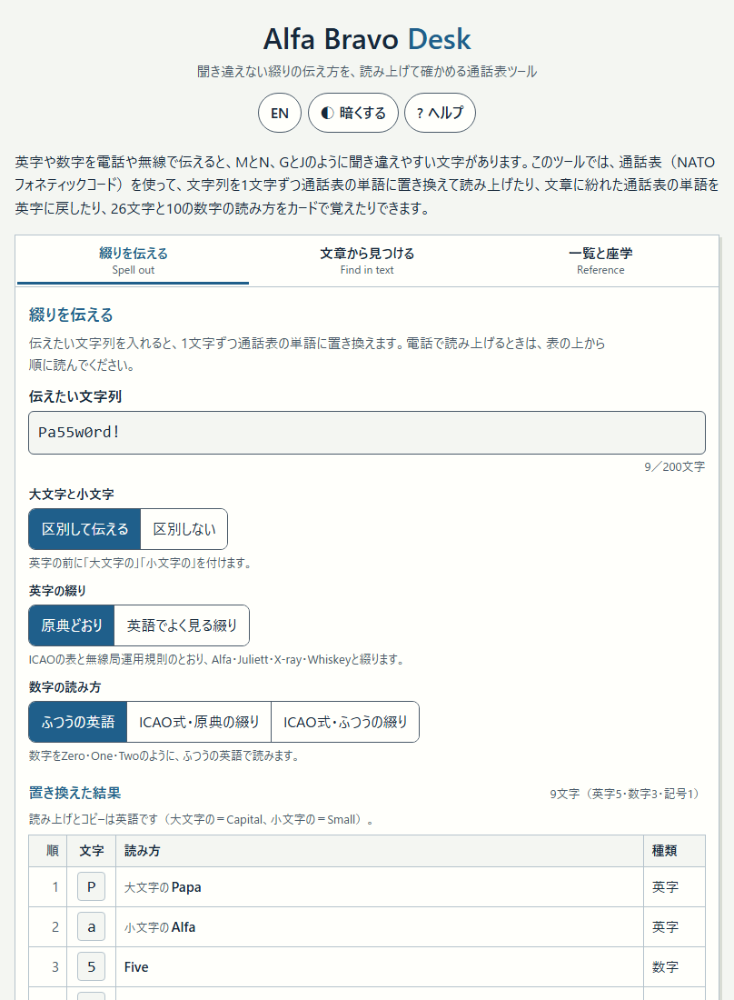
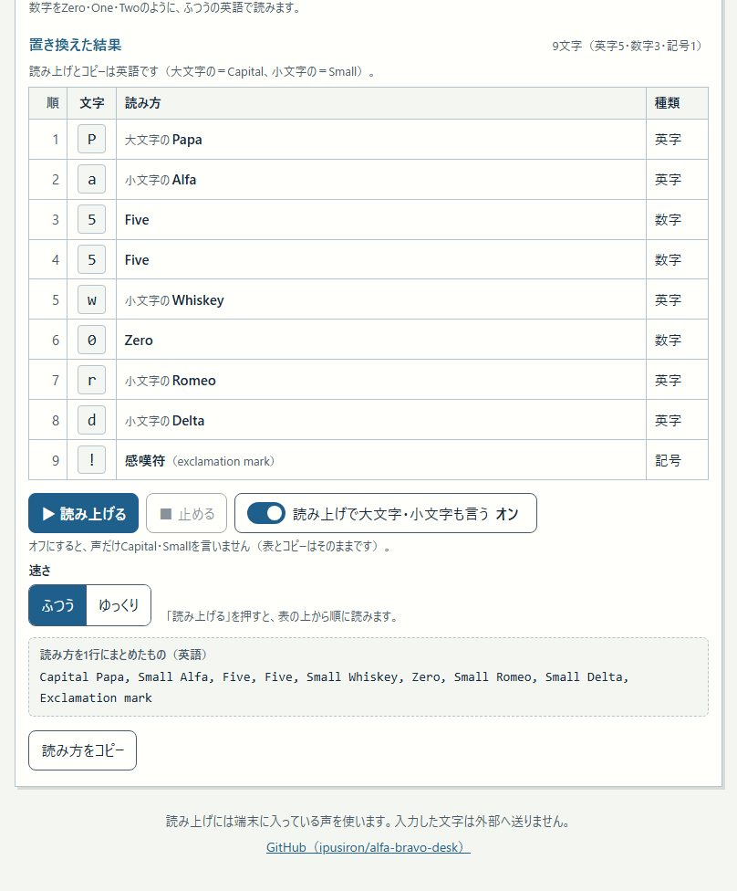
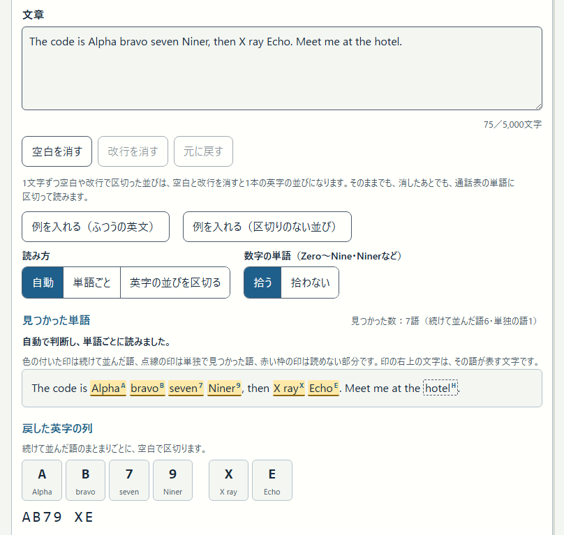
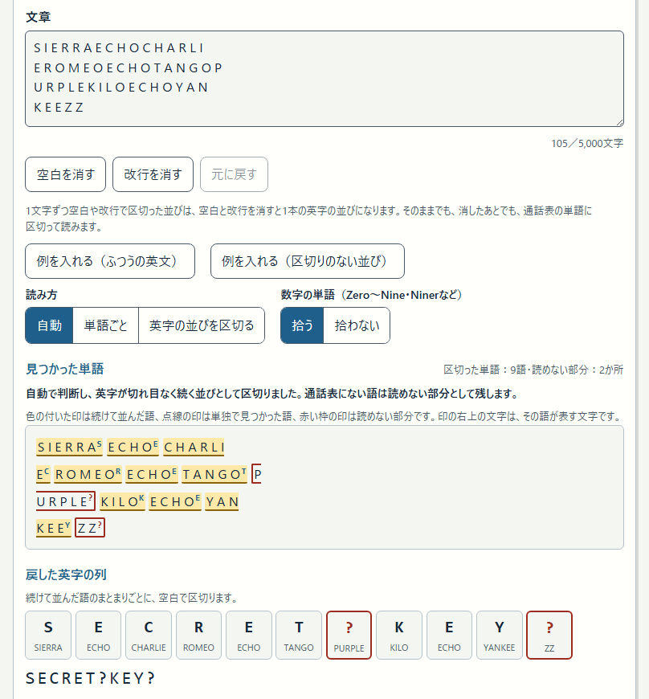
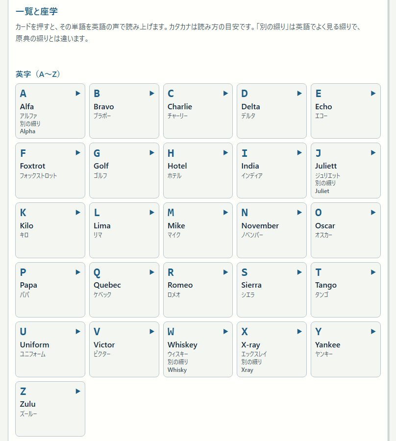
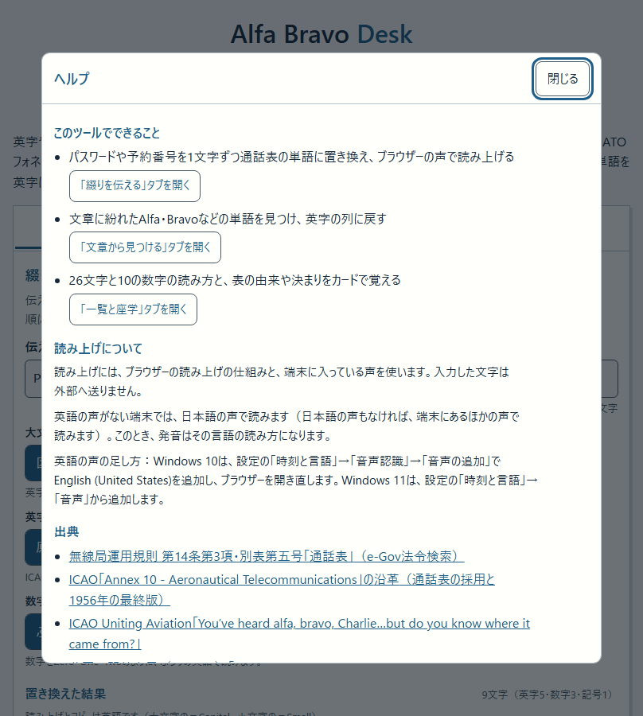

<!--
---
id: day129
slug: alfa-bravo-desk

title: "Alfa Bravo Desk"
subtitle_ja: "聞き違えない綴りの伝え方を、読み上げて確かめる通話表ツール"
subtitle_en: "Spell it out with the NATO phonetic alphabet, find it in text, and hear it"

description_ja: "英字や数字を声で聞き違えずに伝えるための通話表（NATOフォネティックコード）を、伝える・文章から見つける・覚えるの3つの場面で使うツール。文字列を1文字ずつ通話表の単語に置き換えてブラウザーの声で読み上げ、文章や区切りのない英字の並びに紛れた通話表の単語を英字に戻す。26文字と10の数字のカードと、表の由来や決まりの座学もある。入力した文字は外部へ送らない。日英対応。"
description_en: "A tool for the NATO phonetic alphabet (the ICAO spelling alphabet), the code words used to pass letters and digits by voice without mishearing, in three situations: spelling out, finding in text and learning. It turns text into code words and reads them aloud in the browser's voice, turns code words hidden in a text or in an unbroken run of letters back into letters, and shows cards for the 26 letters and 10 digits with background notes. Nothing you type is sent anywhere. Japanese and English UI."

category_ja:
  - 通信技術
  - 符号化
  - 学習支援
category_en:
  - Communication Technologies
  - Encoding
  - Learning Support

difficulty: 1

tags:
  - nato-phonetic-alphabet
  - spelling-alphabet
  - icao
  - radiotelephony
  - text-to-speech
  - web-speech-api
  - education

repo_url: "https://github.com/ipusiron/alfa-bravo-desk"
demo_url: "https://ipusiron.github.io/alfa-bravo-desk/"
hub: true
---
-->

# Alfa Bravo Desk - 聞き違えない綴りの伝え方を、読み上げて確かめる通話表ツール

[English](README.en.md) · 日本語

[](https://github.com/ipusiron/alfa-bravo-desk/stargazers)
[](https://github.com/ipusiron/alfa-bravo-desk/forks)
[](https://github.com/ipusiron/alfa-bravo-desk/commits)
[](LICENSE)
[](https://ipusiron.github.io/alfa-bravo-desk/)

**Day129 - 生成AIで作るセキュリティツール200**

Alfa Bravo Deskは、英字や数字を電話や無線で聞き違えずに伝えるための通話表（NATO phonetic alphabet、NATOフォネティックコード）を、伝える側と聞き取る側の両方から使うツールです。文字列を1文字ずつ通話表の単語に置き換えてブラウザーの声で読み上げる「綴りを伝える」、文章や区切りのない英字の並びに紛れた通話表の単語を英字に戻す「文章から見つける」、26文字と10の数字の読み方をカードで覚える「一覧と座学」の3つのタブがあります。

パスワードや予約番号を電話で伝えるときの、大文字と小文字・0とO・1とlの言い分けも扱います。読み上げには端末に入っている声を使い、入力した文字は外部へ送りません。

## 🌐 デモページ

👉 **[https://ipusiron.github.io/alfa-bravo-desk/](https://ipusiron.github.io/alfa-bravo-desk/)**

ブラウザーで直接お試しいただけます。ビルドもインストールも要りません。リポジトリーをダウンロードして`index.html`を開く（`file://`で開く）だけでも動きます。

見出しにあるボタン3つ（幅900px未満では題名の下）は、言語の切り替え（「EN」。英語の画面では「JA」）・明暗の切り替え・ヘルプです。ヘルプには、このツールでできること・読み上げについて・出典・関連ツールをまとめています。開いているタブはURLの`#spell`・`#find`・`#reference`で示し、このURLを開くとそのタブから始まります。

## 📸 スクリーンショット

ライトモードの日本語の画面です。ダークモードは見出しの「暗くする」、英語の画面は「EN」のボタンで切り替えます。英語の画面の画像は[README.en.md](README.en.md)に載せています。



> *開いた直後の「綴りを伝える」タブ（例の`Pa55w0rd!`を1文字ずつ通話表の単語に置き換えた表）*



> *読み上げのボタン・大文字と小文字を言うかのスイッチ・速さの切り替えと、コピーする1行*



> *「文章から見つける」タブ。ふつうの英文の例で、続けて並んだ語を英字の列に戻し、単独の語（hotel）は別に出す*



> *1文字ずつ空白と改行で区切った並びの例。通話表の単語に区切り、読めない部分（PURPLE・ZZ）を「?」にする*



> *「一覧と座学」タブ。カードを押すとその単語を読み上げる*



> *ヘルプ（このツールでできること・読み上げについて・出典・関連ツール）*

## ✨ 機能

- 綴りを伝える：文字列（200文字まで）を1文字ずつ通話表の単語に置き換え、表（順・文字・読み方・種類）に出す。文字の欄は等幅の枠で、0とO・1とlを見分けやすくする
- 大文字と小文字：区別するときは「大文字の」「小文字の」（声とコピーはCapital・Small）を付け、区別しないときは単語だけにする
- 英字の綴り：原典どおり（Alfa・Juliett・X-ray・Whiskey）と、英語でよく見る綴り（Alpha・Juliet・Xray・Whisky）を切り替える
- 数字の読み方：ふつうの英語（One・Two…）・ICAO式の原典の綴り（Wun・Too・Tree・Fower・Fife・Ait・Niner）・ICAO式のふつうの綴り（3・5・9だけTree・Fife・Niner）の3つ
- 記号：パスワードによく使う18個（`! @ # $ % & * - _ . , ? / + = : ; ~`）に名前を付ける。名前のない記号と日本語などは「読み替えなし」として、読み上げでは飛ばす
- 読み上げ：ボタンを押したときだけ、1語ずつ間を空けて読み、いま読んでいる行に印を付ける。速さはふつう（1.0）とゆっくり（0.7）。大文字・小文字を言わないスイッチもある（表とコピーはそのまま）
- 文章から見つける：文章（5,000文字まで）の中の通話表の単語に印を付け、2語以上続けて並んだ語を英字の列に戻す。1語だけ離れてある語は「単独で見つかった語」に分ける。綴りの揺れ（Alpha・Juliet・Whisky・X rayなど）とICAO式の数字も拾う
- 区切りのない英字の並び：`ALPHAMIKEECHO`のような並びや、1文字ずつ空白・改行で区切った並びを、通話表の単語に区切って読む。読めない部分は「?」にして一覧に出し、推測では埋めない。読み方は自動で決め、「単語ごと」「英字の並びを区切る」を手で選ぶこともできる
- 空白と改行を消す：入力欄の空白・改行を取り除くボタンと、1段だけ元に戻すボタン
- 一覧と座学：26文字と10の数字のカード（綴り・読み方の目安のカタカナ・別の綴り・ICAO式）と、座学のカード6枚（何のための表か・ICAOとNATO・綴りの決まり・数字の読み方・日本の通話表・伝え間違いを防ぐために）
- 英語の声がない端末では、日本語の声（なければ端末にあるほかの声）で読み、注意の帯で知らせる。英語の声の足し方も出す
- 日英の画面、明暗の切り替え、幅320pxから使える画面

## 📖 使い方

1. 「綴りを伝える」タブで、伝えたい文字列を入れます。表の上から順に読むと、電話で伝えられます。「▶ 読み上げる」で英語の声で読み、「読み方をコピー」で1行の文をコピーします。
2. 「文章から見つける」タブで、文章を貼ります。見つかった単語に印が付き、続けて並んだ語が英字の列に戻ります。1文字ずつ区切った並びや、空白のない並びも、そのまま貼れば区切って読みます。
3. 「一覧と座学」タブで、カードを押すとその単語を読み上げます。座学のカードで、表の由来や決まりを読めます。

## 🎯 ユースケース

### このツールならではの使い方

- 認証コードや予約番号を電話で伝える前に、読み方を確かめる：サポート窓口の人が`Rx9-Lp`のような文字列を入れると、`Capital Romeo, Small X-ray, Nine, Hyphen, Capital Lima, Small Papa`と1行で出ます。この1行を見ながら読めば、大文字と小文字・記号の言い忘れを防げます。
- 見分けにくい文字が混じるパスワードを、口頭で伝える練習に使う：家族にWi-Fiのパスワードを伝えるとき、`O0l1`を入れると`Capital Oscar, Zero, Small Lima, One`となり、数字と英字を取り違えやすい所がわかります。
- 謎解きや暗号のゲームで出た、区切りのない並びを英字に戻す：1文字ずつ空白と改行で区切った並びを貼ると、通話表の単語に区切り、英字の列（例の並びでは`SECRET?KEY?`）にします。通話表にない語は「?」として残るので、どこが読めなかったかを一覧で確かめられます。
- 数字の読み方の違いを、無線の講習で見比べる：`3159`を入れて数字の読み方を切り替えると、ふつうの英語の`Three, One, Five, Nine`、ICAO式の原典の綴りの`Tree, Wun, Fife, Niner`、ICAO式のふつうの綴りの`Tree, One, Fife, Niner`が並びます。
- 聞き取りの練習の答え合わせに使う：ひとりが「ゆっくり」で読み上げ、もうひとりが聞こえた単語を書き取ります。書き取った文を「文章から見つける」に貼ると英字の列に戻るので、元の文字列と比べられます。

### ほかの使い方

- 英語の授業や無線の講習で、通話表の26語と数字の読み方を、カードを押して声で確かめる。
- 航空・船舶・アマチュア無線の通話表の由来（ICAOが1956年から使う最終版）や、日本の欧文通話表・和文通話表の違いを、座学のカードで読む。
- 電話でパスワードや認証番号を聞き出す手口について、伝えてよい相手かを確かめる大切さを、座学のカード「伝え間違いを防ぐために」を使って話し合う。

### 限界

- 読み上げの声は端末に入っている声で、発音は声によって違います。英語の声がない端末では、日本語などほかの言語の読み方になります。
- 区切りのない並びの読み取りは、読めない文字がもっとも少なくなる区切り方を選ぶだけで、意味が通るかは確かめません。通話表にない語は読みません。

## 🔬 技術的な説明

- 計算部（`js/abd-core.js`）はDOMに触れず、変換・見つける処理・綴りの揺れの表・記号の名前・読み上げ用の綴りの置き換え・速さと間の定数を持ちます。テストから直接呼びます。
- 区切りのない並びは、英字（A〜Z）だけを1本につなぎ、通話表の語（綴りの揺れと数字の語を含む）への区切り方のうち、読めない文字がもっとも少なく、同じなら語の数が少ないものを動的計画法で選びます。読めない文字が続いた部分ごとに「?」を1つ置きます。
- 自動の判断では、2つの読み方で読めた英字の割合を比べます。英字の並びとして読んだ割合が0.7以上で、単語ごとに読んだ割合より0.2以上多ければ、英字の並びとして区切ります。単語ごとに読むときも、9文字以上のまとまりで8割以上読めたものは、そのまとまりだけを区切ります。
- 読み上げはブラウザーのWeb Speech API（`speechSynthesis`）を使います。声は英語（en-US、en-GB、そのほかのenの順）→日本語→そのほかの最初の声の順に選びます。語と語の間は、ふつう350ミリ秒・ゆっくり700ミリ秒です。
- 声が崩れやすい綴りは、読み上げのときだけ置き換えます（Juliett→Juliet、Alfa→Alpha、Wun・Too・Ait→One・Two・Eight、Fower→Fow-er、Xray→X-ray）。画面とコピーには選んだ綴りを出します。

## 🔒 セキュリティ

- 入力した文字は外部へ送りません。外部と通信するコード（fetchなど）はありません。
- CSPは`default-src 'none'`を基本に、スクリプトとスタイルは同じ場所のファイルだけに限っています。インラインのスクリプト・スタイル・イベントハンドラーはありません。
- 文字は`textContent`と要素の組み立てだけで画面に入れ、HTMLとして解釈しません。
- 保存するのは言語と明暗の選択だけ（localStorage）で、入力した文字は保存しません。

## 🔗 参考

- [無線局運用規則 第14条第3項・別表第五号「通話表」（e-Gov法令検索）](https://laws.e-gov.go.jp/law/325M50080000017)
- [ICAO「Annex 10 - Aeronautical Telecommunications」の沿革](https://www.icao.int/sites/default/files/postalhistory/annex_10_aeronautical_telecommunications.htm)
- [ICAO Uniting Aviation「You’ve heard alfa, bravo, Charlie…but do you know where it came from?」](https://unitingaviation.com/?p=18560)
- [英国民間航空局（UK CAA）「CAP 413 Radiotelephony Manual」](https://www.caa.co.uk/our-work/publications/documents/content/cap-413/)
- 関連ツール：[MorseTree Visualizer](https://ipusiron.github.io/morse-tree-visualizer/)・[Polybius CipherLab](https://ipusiron.github.io/polybius-cipherlab/)

## 🧪 テスト

```bash
npm test
```

- Node.js 22以上で動き、依存はありません。GitHub Actionsでpushとpull requestのたびに自動で実行します。
- 計算部（変換・見つける処理・区切り・自動の判断・声の選び方）、日英の辞書、index.htmlの構造とCSP、配色のコントラスト比、READMEの構造と例の値を確かめます。READMEの例の値は、計算部で出し直して照らし合わせます。
- 画面の検査（`test/interface.browser.py`）は、PythonのPlaywrightでChromium・Firefox・WebKitを動かします（CIには入れていません）。

## 📁 ディレクトリー構造

```text
alfa-bravo-desk/              # リポジトリーのルート
|-- .gitattributes            # 改行をLFに保つ
|-- .github/                  # GitHubの設定
|   `-- workflows/            # 自動テストの定義
|       `-- test.yml          # pushとpull_requestのたびに構文の確認とnpm test（Node 22）
|-- LICENSE                   # MIT
|-- README.md                 # 日本語の説明（YAMLはここだけ）
|-- README.en.md              # 英語の説明（README.mdと同じ節）
|-- index.html                # 画面（CSP・OGP・ヘルプ）
|-- style.css                 # 見た目・明暗の色・狭い画面の並び
|-- theme-init.js             # 描画の前に明暗を決める
|-- app.js                    # 画面の処理（DOMと読み上げ）
|-- package.json              # npm testの定義（依存なし）
|-- js/                       # 計算部と文言
|   |-- abd-core.js           # 計算部（変換・見つける処理・区切り・声の選び方。UMD・DOM非依存）
|   |-- messages.js           # 日英の辞書
|   `-- i18n.js               # 言語の選択と、語の切れ目での折り返し
|-- assets/                   # READMEの画面の画像（screenshot.pngは共有のときの画像にも使う）
|   |-- screenshot.png        # 開いた直後の「綴りを伝える」タブ
|   |-- screenshot2.png       # 読み上げのボタンとコピーの欄
|   |-- screenshot3.png       # 「文章から見つける」タブ（ふつうの英文）
|   |-- screenshot4.png       # 「文章から見つける」タブ（区切りのない並び）
|   |-- screenshot5.png       # 「一覧と座学」タブのカード
|   |-- screenshot6.png       # ヘルプ
|   `-- en/                   # 英語の画面
|       |-- screenshot.png    # 開いた直後（英語）
|       |-- screenshot2.png   # 読み上げのボタン（英語）
|       |-- screenshot3.png   # ふつうの英文（英語）
|       |-- screenshot4.png   # 区切りのない並び（英語）
|       |-- screenshot5.png   # カード（英語）
|       `-- screenshot6.png   # ヘルプ（英語）
`-- test/                     # 自動テスト
    |-- core.test.js          # 変換・記号・数字・綴りの切り替え・読み上げの置き換え・声の選び方
    |-- find.test.js          # 文章から見つける・区切りのない並び・自動の判断・空白と改行を消す
    |-- i18n.test.js          # 日英の辞書のキー・使わない語・言語の選び方
    |-- structure.test.js     # index.htmlの構造・CSP・OGP・ヘルプ・送信と保存の禁止
    |-- contrast.test.js      # 文字と背景のコントラスト比
    |-- format.test.js        # 最長行と行数
    |-- readme.test.js        # READMEの構造・YAML・見出しの対応・例の値・画像
    `-- interface.browser.py  # 画面の検査（PythonのPlaywright。CIに入れない）
```

## 💻 動作環境

- HTML・CSS・通常のJavaScript（UMD形式）だけで動く。ビルドも、実行時の外部ライブラリーも要らない。
- `index.html`をブラウザーで開くだけで動く。ダウンロードして`file://`で開いても、GitHub Pagesでも同じである。
- 読み上げには、Web Speech APIに対応したブラウザーと、端末に入っている声が要る。
- テストに要るのは、Node.js 22以上（`npm test`）である。画面の検査には、PythonとPlaywright（Chromium・Firefox・WebKit）が要る。

## 📄 ライセンス

ソースコードのライセンスはMIT Licenseです（[LICENSE](LICENSE)。Copyright (c) 2026 ipusiron）。実行時に読み込む外部ライブラリーはありません。参考に挙げた資料には、それぞれの権利が適用されます。

## 🛠️ このツールについて

本ツールは、「生成AIで作るセキュリティツール200」プロジェクトの一環として開発されました。
このプロジェクトでは、AIの支援を活用しながら、セキュリティに関連するさまざまなツールを100日間にわたり制作・公開していく取り組みを行っています。

プロジェクトの詳細やほかのツールについては、以下のページをご覧ください。

🔗 [https://akademeia.info/?page_id=44607](https://akademeia.info/?page_id=44607)

ツールの一覧と学習の入口は、[ハッキング・ラボ・オンライン](https://hackinglab.online/)にまとめています。

このツールの進捗は、[ハッキング・ラボ・オンラインのこのツールのカード](https://hackinglab.online/#day129)で付けられます。
